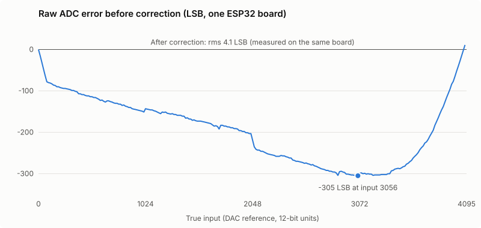
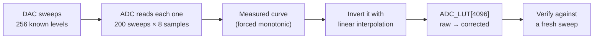

# esp32-adc-lut

**Make the ESP32's ADC read in a straight line.** Measures your own chip's ADC curve using its built-in DAC, then generates a 4096-entry lookup table that corrects the curve. It takes 26 seconds and needs one jumper wire, with no external parts.

```cpp
float corrected = ADC_LUT[analogRead(35)];   // that's the whole runtime cost: one array read
```

| Measured on one ESP32 DevKit | Max error | RMS error |
|---|---:|---:|
| Raw `analogRead()` | 307 LSB | 212.8 LSB |
| **With the generated table** | **37.5 LSB** | **4.1 LSB** |

That is about **50× less typical error**, measured on a real board by the generator's own verification pass (251 DAC steps, 64 samples each).



---

## Why the ESP32 needs this

The ESP32's 12-bit ADC turns 0–3.1 V into 0–4095, but not along a straight line:

- **Dead zone at the bottom.** Below roughly 0.1 V it reads 0.
- **Bent middle.** On the board above, it reads up to **305 counts too low** around 3/4 scale. That is about 7.5% of full range.
- **Saturation at the top.** Above roughly 3.1 V it reads 4095.
- **Every chip is different,** so a table copied from someone else's board won't fit yours.

The result: a battery monitor that cuts off at the wrong voltage, sensors that read non-proportionally, and thresholds that trip in the wrong place.

## How it works

The ESP32 has an 8-bit DAC on GPIO25. Wire it to an ADC pin, and the chip can measure its own ADC against a known staircase of 256 voltages:



1. **Measure.** The DAC steps through codes 0..255, and the ADC samples each step. The whole sweep repeats 200 times, interleaved, so slow drift (temperature, supply) averages out evenly across all points instead of biasing one end.
2. **Clean.** Noise can make step *k+1* read lower than step *k*, which is physically impossible on a rising input and would fold the table. Each point is clamped to at least its predecessor.
3. **Invert.** For every possible raw reading *r* in 0..4095, the generator finds the two measured points that bracket it and interpolates between them. The answer is on the DAC scale, where code *k* maps to *16k*, so corrected values stay in 0..4095 just like raw ones.
4. **Verify.** A fresh sweep runs the new table on live readings and prints the error before and after correction.
5. **Print.** The table goes out on Serial as C source, ready to paste.

## Quick start

**You need:** any ESP32 with GPIO25 (DAC1) and GPIO35 (ADC1_CH7) exposed (most DevKits), a jumper wire, and Arduino IDE 2.x or arduino-cli with the [ESP32 core](https://github.com/espressif/arduino-esp32).

```
 ESP32 DevKit
 ┌────────────┐
 │     GPIO25 ├──┐   DAC1 out
 │            │  │   one short jumper,
 │     GPIO35 ├──┘   nothing else on either pin
 └────────────┘
```

1. Connect **GPIO25 → GPIO35**.
2. Open [`generator/generator.ino`](generator/generator.ino), select your board, and upload.
3. Open the Serial Monitor at **115200**. After about 26 seconds you'll see:
   ```
   Measuring..........
   Verify over 251 DAC steps (error vs DAC scale, in LSB):
     raw       : max 307.0  rms 212.8
     corrected : max 37.5  rms 4.1

   const float ADC_LUT[4096] = {
   0.00,77.30,80.88,81.97, ...
   ```
4. Copy everything from `const float ADC_LUT` through `};` into a file named `adc_lut.h` in your project.

With arduino-cli:

```bash
arduino-cli compile --fqbn esp32:esp32:esp32 --upload -p COM5 generator
```

## Using the table

```cpp
#include "adc_lut.h"

void setup() {
  analogReadResolution(12);
  analogSetAttenuation(ADC_11db);   // must match what the table was generated with
}

void loop() {
  float corrected = ADC_LUT[analogRead(35)];
}
```

[`examples/use_lut`](examples/use_lut) is a complete sketch that streams `raw` and `corrected` side by side to the Serial Plotter. Its `adc_lut.h` came from the author's board. **Replace it with yours.**

Options in `generator.ino`:

| Define | Default | Meaning |
|---|---|---|
| `SWEEPS` | 200 | Full 0..255 sweeps. More sweeps average out more noise and take longer. |
| `SAMPLES` | 8 | Reads per step per sweep. |
| `SETTLE_US` | 100 | DAC settle time before reading. |
| `INT_LUT` | off | Uncomment it to get `const int` (rounded) instead of `const float`. |

## Where this came from, and what changed

This is a rewrite of [**e-tinkers/esp32-adc-calibrate**](https://github.com/e-tinkers/esp32-adc-calibrate) by Henry Cheung, which is itself based on [**Helmut Weber's** ESP32-ADC](https://github.com/MacLeod-D/ESP32-ADC), first described [on the ESP32 forum](https://esp32.com/viewtopic.php?f=19&t=2881&start=30#p47663). The idea is theirs: use the DAC as a reference and correct the ADC with a table. This repo keeps that idea and the output format, and reimplements the rest. The upstream code has had no code changes since July 2020.

| | Upstream v2 (2020) | This repo (v3) |
|---|---|---|
| Building the table | Expand to 20,480 points, then brute-force nearest match for each of 4095 readings: **~84 million comparisons** | Direct piecewise-linear inversion: **~1 million simple steps** |
| Sub-step interpolation | **Bug:** steps of 1/10 read back as 1/5 (see below) | Exact interpolation, so the bug no longer exists |
| Averaging | EMA (`0.9·old + 0.1·new`) starting from 0 | Plain mean over 200 interleaved sweeps × 8 samples |
| Noise folding | Not handled | Curve forced monotonic before inversion |
| RAM during generation | ~96 KB (two float arrays) | **~2 KB** |
| Self-check | None. You copy the table and hope it's right. | **Verification pass** prints error before and after correction |
| DAC API | `driver/dac.h` (legacy IDF driver) | `dacWrite()`, the Arduino core API |
| Serial speed | 500000 | 115200 (the default in every serial monitor) |
| Output format | `const float ADC_LUT[4096]` | Same, so upstream's example works unchanged |

### The bug, in detail

Upstream subdivides each interval of the interpolated curve into 5 sub-points:

```cpp
for (int j=0; j<5; j++)
   Res2[i*5+j] = Results[i] + (Results[i+1] - Results[i]) * (float)j / (float)10.0;   // ← /10
```

With `j = 0..4`, `j/10` covers fractions **0, 0.1, 0.2, 0.3, 0.4**. That is only the lower 40% of each interval. The best match is then decoded as `index / 5`, which reads those same sub-points as fractions **0, 0.2, 0.4, 0.6, 0.8**. As a result:

- every sub-step match is reported at **twice** its true fractional position, and
- the upper 60% of every interval has no sub-points at all, so readings there snap to the start of the next interval.

The error is small, always under one output count, because the intervals are already fine. But it is systematic, and it went into every table generated with that code. The consistent fix would be `/5.0`. v3 removes the whole subdivide-and-search step, so the fix isn't needed.

## Limitations (read before trusting the numbers)

- **The DAC is the reference.** The table makes the DAC→ADC pair linear, not the ADC alone. If the ESP32's DAC has its own error, that error stays in the table. You get a *straight* response, not a *volt-accurate* one. For absolute volts, check a few points against a good multimeter, or use an external ADC such as the ADS1115.
- **The dead zones can't be corrected.** Below about 0.1 V the ADC returns 0, so the table can't know what the actual voltage was. Design your input divider so the signal stays in the middle of the range.
- **One table per chip, per setting.** It is tied to the chip, the attenuation (`ADC_11db`), and 12-bit resolution. If you change any of these, generate a new table.
- **Remaining error spikes.** On the test board the 37.5 LSB maximum came from two spots: the first step above the dead zone, and one 33-count jump at raw 1828, most likely a missing code in the ADC itself. Everywhere else the error stays within a few counts.
- **Noise is not removed.** The table corrects shape, not jitter. Average several readings if your signal is noisy.
- **Tested on:** ESP32 (classic) DevKit with CP2102, Arduino-ESP32 core 3.3.12. The ESP32-S2 has a DAC but different pins. The S3/C3 have no DAC. Those chips use Espressif's curve-fitting calibration instead.

## Alternatives

| Approach | When it fits |
|---|---|
| This LUT | Classic ESP32, you want the best linearity from the internal ADC, 16 KB of flash is fine |
| [`analogReadMilliVolts()`](https://docs.espressif.com/projects/arduino-esp32/en/latest/api/adc.html) / [`esp_adc_cali`](https://docs.espressif.com/projects/esp-idf/en/latest/esp32/api-reference/peripherals/adc_calibration.html) | You want volts out of the box and can live with the classic ESP32's line-fitting error at the ends of the range |
| External ADC (ADS1115, MCP3421…) | You need real accuracy, not just linearity |

## Credits

- **Helmut Weber**: the original DAC-loopback LUT technique ([MacLeod-D/ESP32-ADC](https://github.com/MacLeod-D/ESP32-ADC))
- **Henry Cheung** ([e-tinkers](https://github.com/e-tinkers)): the Arduino adaptation, bug fixes and documentation ([e-tinkers/esp32-adc-calibrate](https://github.com/e-tinkers/esp32-adc-calibrate))

The upstream repository has no license file, so no upstream code or images are copied here. Everything in this repo is a new implementation, released under the [MIT License](LICENSE).
